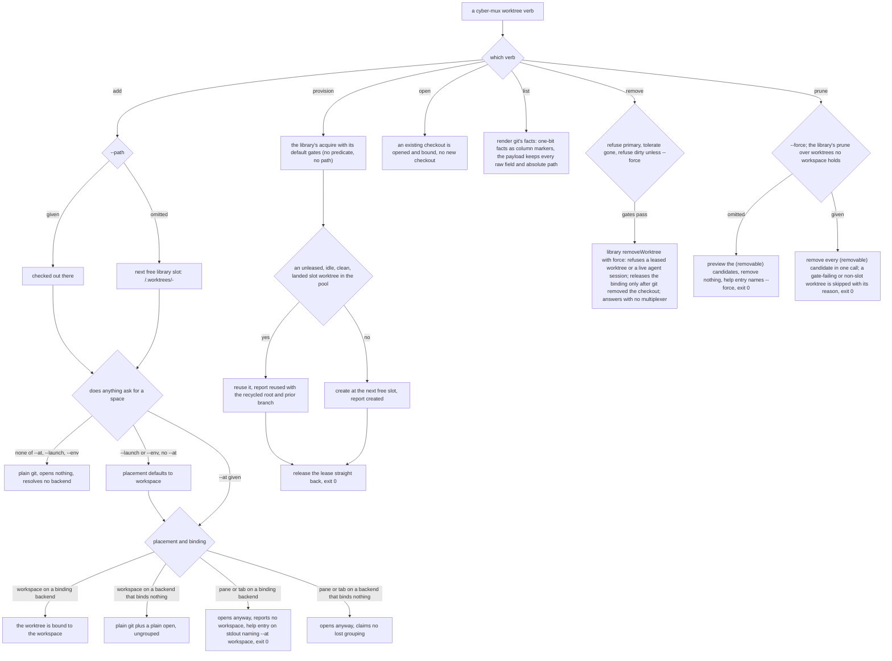

# cli/worktree — the CLI worktree surface

## What

The `cyber-mux worktree <verb>` command surface — **add, provision, open, list, remove, prune** — the
public CLI over the library worktree seam. This node owns **invocation and presentation**: which verbs
exist, how each defaults its flags, how it groups an opened checkout in a workspace where the backend
binds, and how it renders git's facts into the human table and the structured payload. The
surface-independent contract those verbs call is two layers: cyber-mux's own `removeWorktreeSafely`
and `gitWorktreeAdapter` in the [`mux/worktree/`](../../mux/worktree/README.md) seam, and the async
library `@cyberuni/agent-harness/worktrees` (listing, the merged / dirty / landed signals, `acquire`
reuse, `removeWorktree`, prune). This node does not restate either, it drives them.

The surface split exists because the CLI and the library **diverge in what they expose**: a verb
wires the library's `acquire` with its default gates and offers no predicate or path choice, while
the library takes both. That divergence cannot live in a single capability-first node, so the CLI
surface earns its own.

### Non-goals

- **The library contract itself** — what `acquire` guarantees on reuse, how the landed signal is
  computed, how prune decides. Those live in `@cyberuni/agent-harness/worktrees`. How
  `removeWorktreeSafely` orders its gates against the binding release is the cyber-mux seam's, in
  [`mux/worktree/`](../../mux/worktree/README.md).
- **Where a pane lands and what `open` reports back** — that is [`mux/placement/`](../../mux/placement/README.md)'s
  business. The worktree **binding** and a pane's workspace **occupancy** are different questions.

## Use Cases

- **`worktree add`** — create a git worktree, and open it when a placement is asked for. `--path`
  defaults to the **next free slot** beside the primary checkout
  (`<parent>/<repo>.worktrees/<repo>-<n>`, the library's `slotPath`), never nested inside it, so the
  library's prune and reuse recognize the checkout; an explicit `--path` is honored as given.
  `--base` sets the branch start-point. With **none of `--at`, `--launch`, `--env`** it is
  plain git: it opens nothing and resolves no backend, so it works outside any multiplexer — the only
  route that does. `--launch` and `--env` each imply `--at workspace` (asking for something *in* a
  pane is asking for the pane), and `workspace` is the only placement a backend can bind a worktree
  to. `--label` names the tier `--at` opened; omitted, the backend's own default stands (herdr's is
  the checkout path's basename).

- **`worktree provision`** — reuse an idle worktree, else create — the CLI wiring of the library's
  `acquire` with its **default gates**: it reuses one of the library's own slot worktrees that is
  unleased, idle, clean, and landed, else creates one at the next free slot. A one-shot verb has no
  later moment to release, so it **gives the lease straight back**. Flags are `--branch`, `--base`,
  and `--format` only; there is **no `--path`**. It reports **what it did** — `action` (`reused` |
  `created`), the worktree `{root, branch}`, and on reuse the recycled worktree's root and prior
  branch — on stdout honoring `--format`, exit 0.
  **The surface divergence:** the verb offers **no** flag to inject an availability predicate or
  choose a path. A host that needs either, or must hold the lease, calls the library's `acquire`
  directly.

- **`worktree open`** — open (and, where the backend binds, group) an existing checkout plain git
  created earlier. The remedy that makes "add now, group later" a first-class story.

- **`worktree list`** — every worktree of the repo and the workspace each is open in. It renders git's
  facts and **never restates them**: a one-bit fact earns a **marker on the column it is about**, never
  a column of its own — the primary checkout's branch `(*)`, a vanished checkout's path `(gone)`, a
  disposable worktree's branch `(removable)` (the merged/clean/unoccupied composite compressed to one
  word, and exactly `worktree prune`'s dry-run candidate set). A home-rooted path collapses its prefix to `~`, matched at a path **boundary**. Every marker
  is **human-surface only**: every structured payload keeps each raw field (`merged`, `dirty`, `linked`,
  `prunable`) and the **absolute** path, because that is the surface an agent acts on.

- **`worktree remove`** — remove a git worktree through the CLI. It answers outside a multiplexer (a
  git question), and consults **no** disposability signal the listing renders: it refuses the primary
  checkout, tolerates a worktree already gone (releasing an orphan binding), refuses a dirty one
  unless `--force`, then calls the library's `removeWorktree` with `force: true`, which **never
  removes a leased worktree or one a live agent session works in** (`--force` waives the dirty check
  only). The workspace binding is released only **after** git removed the checkout, so a refused
  removal leaves a bound workspace open. (The gate ordering and non-delegation of the cyber-mux seam
  are in [`mux/worktree/`](../../mux/worktree/README.md).)

- **`worktree prune`** — the bulk remove: every candidate `list` marks `(removable)`, gone in one
  call. It **delegates to the library's prune** over the worktrees no workspace holds, so the two can
  never disagree about which worktrees are free. The **bare form previews** (the destructive default
  must be side-effect-free — a caller sees what would go) and **`--force` applies** it; a worktree
  that fails the gate is skipped and reported with the reason it was kept. A worktree that is not one
  of the library's slots (such as `<repo>.worktrees/<branch>`) is **left alone** and never marked.

## Control Flow

### The verb dispatch

## Scenario map

Every scenario in [`worktree.feature`](./worktree.feature), one row each, grouped by use case.

### git worktree helpers

| Edge | Path (Given) | Scenario |
|---|---|---|
| `--path` omitted → next free library slot beside the primary checkout | `worktree add --branch` with no `--path` | `worktree add defaults the path to the next free library slot beside the primary checkout` |
| `--path` given → checked out there | `worktree add --branch --path` | `worktree add honors an explicit --path` |
| gate: primary checkout → refused | `worktree remove` against the primary checkout's own path | `worktree remove refuses the primary checkout, even with --force` |
| gate: checkout already gone → tolerated, no git removal | a path with nothing checked out there | `worktree remove tolerates a worktree already gone from disk` |
| gate: dirty and no `--force` → refused | a worktree with uncommitted changes, no `--force` | `worktree remove refuses uncommitted changes unless --force` |
| gate: dirty with `--force` → removed | a worktree with uncommitted changes, `--force` | `worktree remove --force discards uncommitted changes without the dirty check` |
| a lease or live agent session → refused even with `--force`, the bound workspace stays open | a leased worktree, or one a live agent session works in | `worktree remove never removes a leased worktree or one a live agent session works in` |

### worktree provision — reuse an idle worktree, else create (the library's acquire)

| Edge | Path (Given) | Scenario |
|---|---|---|
| a reusable candidate exists → reuse it, report the reclaim, hand it back unleased | `provision --branch` with an unleased, idle, clean, landed slot worktree in the pool | `worktree provision reuses an idle worktree in the pool and reports the reclaim` |
| no candidate → create at the next free slot, report created | `provision --branch` with no reusable worktree in the pool | `worktree provision creates a fresh checkout when the pool holds no reusable worktree` |
| explicit `--base` → the provisioned branch starts there | `provision --branch --base` | `worktree provision --base starts the provisioned branch at the given ref` |
| flags are `--branch`, `--base`, `--format` → no predicate injection, no path choice (the surface divergence) | the flags the verb accepts | `the worktree provision verb offers no predicate injection and no path choice` |

### worktree/workspace binding

| Edge | Path (Given) | Scenario |
|---|---|---|
| nothing asks for a space → plain git, no backend resolved | `worktree add` with none of `--at`, `--launch`, `--env` | `a bare worktree add opens nothing, so there is nothing to group` |
| `--launch` with no `--at` → placement defaults to workspace | `worktree add --launch` with no `--at` | `worktree add --launch defaults the placement to workspace` |
| `--env` with no `--at` → placement defaults to workspace | `worktree add --env` with no `--at` and no `--launch` | `worktree add --env defaults the placement to workspace, for --launch's reason` |
| `--at workspace` → bound where the backend binds, ungrouped where it does not | herdr, tmux, wezterm, and zellij | `worktree add --at workspace groups the worktree where the backend binds` |
| pane or tab placement on a binding backend → opens ungrouped | `pane:right`, `pane:down`, and `tab` | `a placement the binding cannot serve falls back rather than failing` |
| pane or tab placement on a backend that binds nothing → no lost-grouping claim | tmux, `--at pane:right` | `a backend that binds nothing falls back without reporting a lost grouping` |
| pane or tab placement on a binding backend → help entry on stdout, exit 0 | a binding backend, `--at pane:right` | `the lost-grouping note is a help entry on stdout, not a line on stderr` |
| `--label` given → names the tier `--at` opened | workspace, tab, and `pane:right` on herdr and tmux | `--label names whatever --at opened, on every backend` |
| `--label` omitted → the backend's own default stands | `cyber-mux` with no `--label` | `--label omitted leaves each backend its own default` |
| `worktree open` → an existing checkout is opened and bound | a checkout made by a bare `add`, open in no workspace | `worktree open groups a worktree that plain git created earlier` |
| `list` → only the binding from the backend | worktrees open in workspaces on a backend that binds | `worktree list reports which workspace each worktree is open in` |
| no multiplexer → `list` and `remove` still answer from git | no multiplexer to be inside of | `worktree list and remove answer outside a multiplexer` |

### The listing renders git's facts; it never restates them

| Edge | Path (Given) | Scenario |
|---|---|---|
| a one-bit fact → a marker on the column it is about, never a column | the primary checkout and a checkout whose directory is gone | `a one-bit worktree fact is marked, never given its own column` |
| composite disposability → one `(removable)` marker, all three inputs required, matching prune's dry-run candidate set | a merged, clean, unoccupied slot worktree | `worktree list answers whether a worktree is still needed, not only whether it is occupied` |
| the composite is a rendering, not a payload field | a marked worktree read as structured output | `the disposability composite is the table's compression, never a field of its own` |
| undeterminable signal → never marked `(removable)`, paired against a determined positive | a detached-HEAD and a gone worktree, beside a determined removable one | `an undeterminable disposability signal is never marked (removable) in the human table` |
| a path under home → the prefix collapses to `~`, matched at a boundary | worktrees under home, and a sibling whose name extends home's own | `a home-rooted worktree path is shortened to ~ in the human table` |
| a structured payload → the fields, never the markers | any worktree whose row the human table marks or shortens | `a table marker never reaches a structured payload` |

### worktree prune — bulk remove of every (removable) candidate

| Edge | Path (Given) | Scenario |
|---|---|---|
| bare → preview, remove nothing, help entry names `--force` | worktrees `list` marks `(removable)` | `worktree prune bare previews the removable candidates and removes nothing` |
| `--force` → remove every candidate in one call; a gate-failing one is skipped with its reason | removable worktrees plus one that fails the gate | `worktree prune --force removes every removable candidate in one call` |
| a worktree outside the library's slots → skipped with its reason, never marked `(removable)` | a merged, clean worktree at `<repo>.worktrees/<branch>` | `worktree prune leaves a worktree that is not one of the library's slots` |
