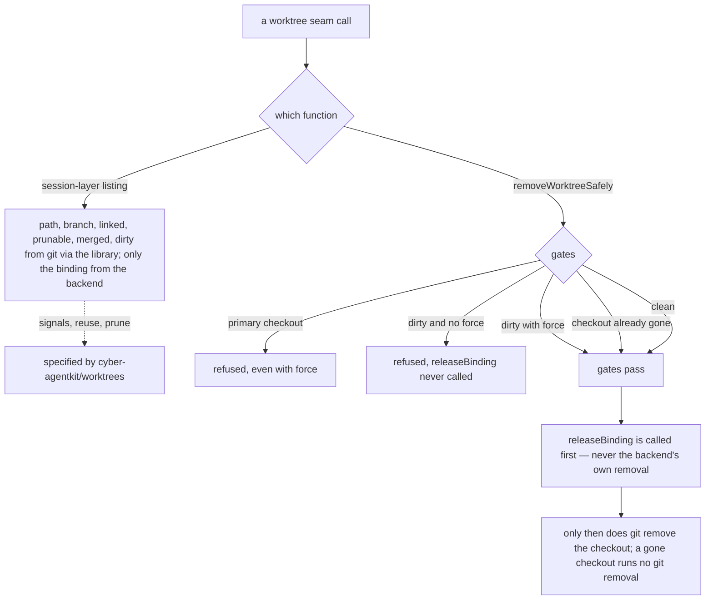

# mux/worktree — the library git-worktree seam

> The **CLI surface** for these helpers — the `cyber-mux worktree <verb>` verbs, their flag defaults,
> and the human table — lives in [`cli/worktree/`](../../cli/worktree/README.md). This node owns the
> **surface-independent library contract** those verbs call.

## What

The worktree seam cyber-mux keeps: `removeWorktreeSafely`, the `gitWorktreeAdapter` (create at a
caller-chosen path), `assertDistinctFromPrimary`, and the `worktreeApi` built on them
(`primaryRoot`, `add`, `removeSafely`). git owns path, branch, linked, prunable, merged, and dirty on
every backend; the one thing a multiplexer contributes is whether a worktree is **bound** to a
workspace, supplied to `removeWorktreeSafely` as a `releaseBinding` callback. Removal is never
delegated to the backend. Because the contract is the same however it is reached, both surfaces — the
CLI verbs and a host calling the functions directly — rest on it.

Listing, the merged / dirty / landed signals, reuse (`acquire`), and prune **moved to
`cyber-agentkit/worktrees`** (v0.7.0), which `cyber-mux/worktree` re-exports. That behavior
is specified there, not here; cyber-mux's old `listWorktreesFromGit`, `isWorktreeRemovable`,
`provisionWorktree`, `pruneWorktrees`, and the layered landed-signal stack were deleted with it.

### Non-goals

- **The CLI presentation** — how a verb defaults its flags, groups an opened checkout, or renders
  git's facts into a `(*)` / `(gone)` / `(removable)` marked table. That is a **surface** concern and
  lives in [`cli/worktree/`](../../cli/worktree/README.md).
- **Listing, disposability signals, reuse, and prune** — owned by `cyber-agentkit/worktrees`.
- **Any worktree fact a backend reports of its own** — git answers those on every backend, so a
  multiplexer is never asked.

Where a pane lands and a pane's workspace **occupancy** are [`placement/`](../placement/README.md)'s
business; the worktree **binding** is a different question and neither answers for the other.

## Use Cases

- **Worktree facts are git's; a backend contributes only the binding** — the session layer reads
  path, branch, linked, prunable, merged, and dirty through the library's `listWorktrees` (git) on
  **every** backend, so two backends can never yield a different branch for the same worktree. A
  multiplexer that also enumerates worktrees is merely re-reading git; the one fact git cannot answer
  is which workspace a worktree is currently open in, and the session layer joins only that, by
  normalized path.

- **Removal reads no disposability signal.** The library reports removability; `removeWorktreeSafely`
  keeps exactly its own gates and consults none, so removability is a fact, never a removal trigger.
  The listing is a pure read.

- **`removeWorktreeSafely` removal is cyber-mux's own gates plus git; only the binding's release is
  delegated.** A backend's own worktree-removal primitive addresses a *workspace* (herdr's takes a
  workspace id), so it cannot reach an unbound worktree at all, and whether it dirty-checks is unknown;
  delegating would make a destructive operation's safety depend on whether a workspace happened to be
  open. **Gate order is a specified property, not an implementation detail**: every gate runs *before*
  the `releaseBinding` callback fires, so a refused removal has no side effect; the release runs
  *before* git removes the checkout, so no binding is left pointing at a directory that no longer
  exists — including for a checkout already gone from disk, where the release still fires and no git
  removal runs.

## Control Flow

### The worktree seam

## Scenario map

Every scenario in [`worktree.feature`](./worktree.feature), one row each, grouped by use case. Reuse,
prune, and the merged / dirty / landed signals are scenarios of `cyber-agentkit/worktrees`.

### the worktree facts are git's

| Edge | Path (Given) | Scenario |
|---|---|---|
| `list` → every worktree fact from git, never the backend's | a backend that also enumerates worktrees | `the library reads every worktree fact from git, whatever the backend` |

### removal is the library's own gates + git; disposability is read, never acted on

| Edge | Path (Given) | Scenario |
|---|---|---|
| the listing reports; remove consults no disposability signal | a worktree the listing would report removable | `the library's remove consults no disposability signal, and the listing never acts` |
| gates run before the binding release | a dirty worktree with a `releaseBinding` callback, no force | `removeWorktreeSafely refuses uncommitted changes BEFORE releasing the binding` |
| release runs before git removes the checkout | a clean worktree with a `releaseBinding` callback, every gate passing | `removeWorktreeSafely releases the binding before git removes the checkout` |
| a gone checkout still has its binding released | a path already gone, with a `releaseBinding` callback | `removeWorktreeSafely releases the binding of a checkout already gone from disk` |
| removal never delegated → this seam's gates plus git | a backend with a worktree-removal primitive of its own | `worktree removal is never delegated to the backend` |
